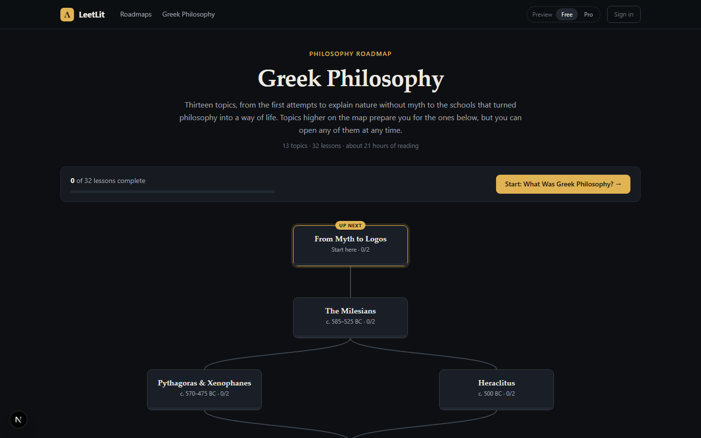

<p align="center">
  
</p>

<p align="center">
  A NeetCode-style learning platform for philosophy, literature and art.
</p>



The prototype has one roadmap, **Greek Philosophy**: 13 topics and 32 lessons, from the Presocratics to the Hellenistic schools.

## Run it

Requires Node 20.9 or newer.

```bash
cd web
npm install
npm run dev
```

Then open <http://localhost:3000>.

For a production build, run `npm run build` and then `npm start`. More detail is in [web/README.md](web/README.md).
